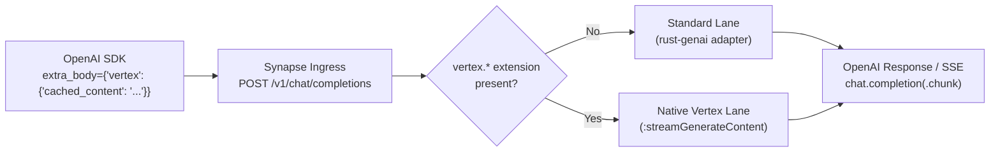

One of Gemini's biggest cost and latency wins on Google Cloud Vertex AI is **Context Caching**
(`cachedContent`). When your application repeatedly queries the same 100,000-token codebase, legal
corpus, or system runbook, pinning that prefix into a Vertex AI cache cuts time-to-first-token
dramatically and bills cached prompt tokens at a fraction of standard input rates.

There is just one catch: if your engineering team standardized on the **OpenAI SDK** (`openai` in
Python or TypeScript) and routes traffic through a conventional OpenAI-compatible proxy,
`cachedContent` disappears. Generic translation proxies flatten every incoming
`POST /v1/chat/completions` body into a lowest-common-denominator chat struct, silently dropping
provider-specific fields before the request ever reaches Vertex AI.

Synapse solves this with its **dual-lane architecture**. Your application keeps importing the exact
same OpenAI client and calling `client.chat.completions.create(...)`, while passing a `vertex`
extension block via `extra_body`. When Synapse sees `vertex.cached_content`, it bypasses the
generic adapter and routes the call down its **native Vertex lane** directly to Vertex AI's
`:streamGenerateContent` endpoint—preserving your cached context handle verbatim and translating
the response back into standard OpenAI `chat.completion` (or `chat.completion.chunk` SSE) frames.

<!-- truncate -->

## Why generic OpenAI proxies drop `cachedContent`

A standard OpenAI-compatible gateway treats every upstream provider identically:

1. Deserialize `POST /v1/chat/completions` into strict OpenAI fields (`model`, `messages`, `temperature`, `tools`, `response_format`).
2. Discard any unknown top-level keys (`extra_body`).
3. Re-encode the normalized request through a generic provider adapter.

Because OpenAI's Chat Completions specification has no concept of an explicit server-side cache
resource name (`projects/.../locations/.../cachedContents/...`), a single-lane proxy has nowhere to
put it. Teams are forced into an unpleasant choice: either abandon the OpenAI SDK and rewrite call
sites against the Google GenAI / Vertex SDK, or pay full price and full prefill latency on every
single turn.

## How Synapse's dual-lane switch works

Synapse inspects every `POST /v1/chat/completions` payload at ingress. If the request contains a
top-level `vertex` object with `cached_content`, `response_schema`, or `thinking_config`, the
lane detector (`RequestWithVertex::needs_native_vertex`) switches that request from the **standard
lane** (`rust-genai`) to the **native Vertex lane** (`NativeVertexClient`).



On the native Vertex lane, Synapse:

- Resolves the route leg in `config/routes.toml` and verifies the first leg is `provider = "vertex"`.
- Acquires and caches a Google Cloud OAuth2 bearer token via Application Default Credentials (ADC).
- Emits a native Vertex AI `GenerateContentRequest` with `cachedContent` set to your cache resource name.
- Streams `:streamGenerateContent?alt=sse` and converts each Vertex chunk into an OpenAI-compatible response or SSE chunk, complete with token usage accounting.

## Step 1: Configure a Vertex route in `config/routes.toml`

Vertex AI context caches are regional resources: a cache created in `us` or `us-central1` can only
be consumed by requests sent to that exact same location and model version. Point your route's first
leg at the matching Vertex `model` and `region`:

```toml
[routes."gemini-pro"]
strategy = "priority"
legs = [
  { provider = "vertex", model = "gemini-2.5-pro", region = "us", project_env = "GCP_PROJECT" },
]
```

Start Synapse with Application Default Credentials configured:

```bash
export GCP_PROJECT="my-gcp-project"
gcloud auth application-default login
cargo run --release -p synapse-gateway
```

## Step 2: Create a Vertex AI `cachedContent` resource

You create the cache once (or on a TTL refresh schedule) using the Vertex AI REST API or Google GenAI
SDK. Here is a minimal `curl` call that caches a large system prompt and codebase snapshot for one
hour (`3600s`) in region `us`:

```bash
CACHE_NAME=$(curl -sS -X POST \
  "https://aiplatform.googleapis.com/v1beta1/projects/${GCP_PROJECT}/locations/us/cachedContents" \
  -H "Authorization: Bearer $(gcloud auth application-default print-access-token)" \
  -H "Content-Type: application/json" \
  -d '{
    "model": "projects/'"${GCP_PROJECT}"'/locations/us/publishers/google/models/gemini-2.5-pro",
    "systemInstruction": {
      "parts": [{ "text": "You are a principal Rust security auditor reviewing the Synapse gateway repository." }]
    },
    "contents": [{
      "role": "user",
      "parts": [{ "text": "<... 60,000 tokens of repository source files and architecture specs ...>" }]
    }],
    "ttl": "3600s"
  }' | jq -r '.name')

echo "Created cache: ${CACHE_NAME}"
# projects/my-gcp-project/locations/us/cachedContents/1234567890123456789
```

:::tip Minimum token threshold
Vertex AI enforces a minimum token count for context caching (typically 32,768 tokens on Gemini 2.5
Pro and 4,096 tokens on Flash models). Payloads below the threshold return `400 INVALID_ARGUMENT`
at cache creation time.
:::

## Step 3: Query the cache from the standard OpenAI SDK

Now call Synapse at `http://localhost:8080/v1` using the unmodified OpenAI SDK. Pass the cache
handle inside `extra_body.vertex.cached_content` (in Python) or the `vertex` property (in
TypeScript / raw HTTP):

### Python (`openai` SDK)

```python
import os
from openai import OpenAI

client = OpenAI(
    base_url="http://localhost:8080/v1",
    api_key="synapse-local",  # or your Synapse bearer token
)

cache_name = os.environ["CACHE_NAME"]

response = client.chat.completions.create(
    model="gemini-pro",
    messages=[
        {
            "role": "user",
            "content": "List every place where upstream HTTP errors are classified as retryable.",
        }
    ],
    extra_body={
        "vertex": {
            "cached_content": cache_name,
        }
    },
)

print(response.choices[0].message.content)
print("Usage:", response.usage)
```

### Streaming + combining `cached_content` with `response_schema` and `thinking_config`

Because `cached_content`, `response_schema`, and `thinking_config` all live inside the same
`vertex` extension block, you can combine **cached context**, **Gemini thinking budgets**, and
**strict Vertex schema-constrained decoding** in a single OpenAI SDK call:

```python
stream = client.chat.completions.create(
    model="gemini-pro",
    stream=True,
    messages=[
        {
            "role": "user",
            "content": "Return the retryable HTTP status codes and their backoff policy.",
        }
    ],
    extra_body={
        "vertex": {
            "cached_content": cache_name,
            "thinking_config": {
                "thinking_budget": 1024,
            },
            "response_schema": {
                "type": "OBJECT",
                "properties": {
                    "retryable_statuses": {
                        "type": "ARRAY",
                        "items": {"type": "INTEGER"},
                    },
                    "uses_exponential_backoff": {"type": "BOOLEAN"},
                },
                "required": ["retryable_statuses", "uses_exponential_backoff"],
            },
        }
    },
)

for chunk in stream:
    delta = chunk.choices[0].delta.content
    if delta:
        print(delta, end="", flush=True)
```

Synapse automatically strips Gemini's internal `thought` parts from the output stream, so the
concatenated `delta.content` chunks form pure JSON conforming to your `response_schema`.

## Verifying native lane execution and cost attribution

Every request served through the native Vertex lane is tagged with `lane="native"` across both
Prometheus metrics and the SQLite / Postgres cost ledger:

```bash
curl -s http://localhost:8080/metrics | grep 'synapse_requests_total.*lane="native"'
```

```text
synapse_requests_total{gen_ai_request_model="gemini-pro",gen_ai_response_model="gemini-2.5-pro",gen_ai_system="vertexai",http_response_status_code="200",lane="native"} 2
```

And in the `requests` ledger table:

```bash
sqlite3 synapse.db \
  "SELECT timestamp, route, model, lane, input_tokens, output_tokens, cost_usd FROM requests ORDER BY id DESC LIMIT 2;"
```

:::note Cached token pricing in the ledger
Vertex AI's `usageMetadata.promptTokenCount` includes both cached and uncached prompt tokens, and
 also reports `cachedContentTokenCount`. Synapse currently prices the full `input_tokens` count at
the model's configured `input` rate in `config/pricing.toml`; dedicated `cached_input` rate
splitting is tracked on the roadmap.
:::

## Try it today

You don't need to fork your application code or maintain two separate LLM client libraries just to
unlock Gemini Context Caching. Point your existing OpenAI SDK at Synapse, attach
`extra_body.vertex.cached_content`, and let the native Vertex lane handle the rest.

- **Step-by-step tutorial**: [Pass `cached_content` to Vertex AI](/docs/get-started/tutorials/native-vertex-caching/)
- **Full reference**: [Native Vertex lane guide](/docs/guides/native-vertex/)
