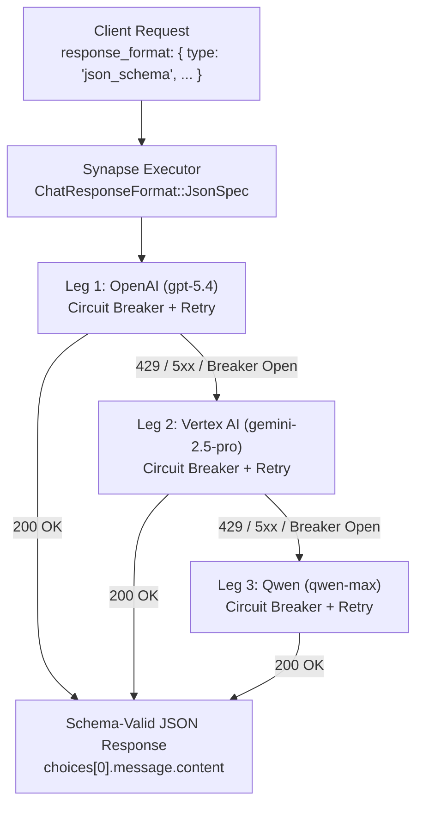

Production AI pipelines rarely consume free-form prose anymore. Whether you are extracting invoice
line items, classifying security alerts, or driving a deterministic state machine, the downstream
caller expects a **strict JSON Schema payload**—not a markdown code fence, not a conversational
preamble, and certainly not a `502 Bad Gateway` when a primary provider hits a rate-limit spike.

Building multi-provider failover (`OpenAI` → `Vertex AI` → `Qwen`) sounds straightforward until
structured outputs enter the picture. Many teams discover during an incident that their backup
provider leg either silently drops `response_format.json_schema` and falls back to unconstrained
text, or leaks reasoning `thought` tokens into the JSON body—turning a transient upstream `429` into
a hard `JSONDecodeError` crash in production.

In this post, we will walk through how Synapse executes **schema-preserving multi-provider
fallbacks**: translating OpenAI `json_schema` specs across heterogeneous providers on the standard
lane, failing over across Vertex AI regions with native `responseSchema` constrained decoding on the
native lane, and protecting every leg with independent circuit breakers.

<!-- truncate -->

## Why naive multi-provider failover breaks structured outputs

When an application sends a structured extraction request using the OpenAI SDK's `response_format`
parameter, three failure modes commonly break DIY fallback wrappers:

1. **Schema stripping on secondary providers.** A naive proxy passes `response_format: { "type": "json_schema", ... }` to OpenAI, but when OpenAI returns `429 Too Many Requests` or `503 Service Unavailable`, the fallback adapter downgrades the request to plain text or generic `json_object` mode on Gemini—losing property types, `required` arrays, and enum constraints.
2. **Mid-stream truncation.** If a non-streaming caller uses an unbuffered pass-through proxy and the upstream connection drops halfway through generating a JSON object, the client receives a truncated `{ "invoice_id": "INV-104", "items": [` payload that cannot be retried cleanly.
3. **Reasoning token contamination.** On reasoning-capable Gemini 2.5 / 3.x models, enabling thinking alongside structured output can emit internal `thought` parts before the final JSON payload unless the gateway explicitly filters them out.

## Pattern 1: Cross-provider `json_schema` fallback on the standard lane

When your client sends a standard OpenAI `response_format` block (`type: "json_schema"` or
`type: "json_object"`), Synapse's executor (`to_genai_options`) converts the schema into a
provider-neutral `ChatResponseFormat::JsonSpec` (including `schema_name`, `schema`, and `strict`)
and attaches that specification to **every leg** in your route's fallback chain.



### Configuring `config/routes.toml`

Here is a priority route that starts on OpenAI (`gpt-5.4`), falls back to Google Cloud Vertex AI
(`gemini-2.5-pro`), and keeps Alibaba Cloud DashScope (`qwen-max`) as a third leg, guarded by a
per-leg circuit breaker and exponential backoff:

```toml
[routes."structured-extractor"]
strategy = "priority"
legs = [
  { provider = "openai", model = "gpt-5.4", api_key_env = "OPENAI_API_KEY" },
  { provider = "vertex", model = "gemini-2.5-pro", region = "us-central1", project_env = "GCP_PROJECT" },
  { provider = "qwen",   model = "qwen-max", api_key_env = "DASHSCOPE_API_KEY" },
]

[retry]
max_attempts = 2
initial_backoff_ms = 150
max_backoff_ms = 1500

[circuit_breaker]
failure_threshold = 3
cooldown_secs = 30
```

### Calling the route with OpenAI `json_schema`

Your application code uses a single `response_format` definition and never needs to know which
upstream provider ultimately fulfilled the call:

```python
import json
from openai import OpenAI

client = OpenAI(
    base_url="http://localhost:8080/v1",
    api_key="synapse-local",
)

incident_schema = {
    "type": "object",
    "properties": {
        "service": {"type": "string"},
        "severity": {"type": "string", "enum": ["SEV1", "SEV2", "SEV3"]},
        "affected_regions": {
            "type": "array",
            "items": {"type": "string"},
        },
        "requires_rollback": {"type": "boolean"},
    },
    "required": ["service", "severity", "affected_regions", "requires_rollback"],
    "additionalProperties": False,
}

response = client.chat.completions.create(
    model="structured-extractor",
    messages=[
        {
            "role": "system",
            "content": "Extract structured incident metadata from the pager alert.",
        },
        {
            "role": "user",
            "content": "ALERT: Checkout API p99 latency > 12s in us-east-1 and eu-west-1 after deploy v2.14.3. Rollback initiated.",
        },
    ],
    response_format={
        "type": "json_schema",
        "json_schema": {
            "name": "incident_report",
            "strict": True,
            "schema": incident_schema,
        },
    },
)

payload = json.loads(response.choices[0].message.content)
print(payload)
# {'service': 'Checkout API', 'severity': 'SEV1', 'affected_regions': ['us-east-1', 'eu-west-1'], 'requires_rollback': True}
```

### What happens when OpenAI fails?

1. **Retryable failure classification**: If OpenAI returns `429 Too Many Requests`, `408 Request Timeout`, any `5xx`, or a transport timeout, Synapse retries `openai/gpt-5.4` up to `max_attempts` with exponential backoff. Non-retryable client errors (`400`, `401`, `422`) skip retries immediately.
2. **Circuit breaker accounting**: Consecutive failures on `openai/gpt-5.4` increment its breaker counter. Once it reaches `failure_threshold = 3`, the breaker trips **Open** (`synapse_circuit_breaker_state{leg="openai/gpt-5.4"} = 2`) for `cooldown_secs = 30`. Subsequent requests skip OpenAI in zero milliseconds and go straight to Vertex AI.
3. **Zero schema loss on Leg 2**: Synapse dispatches the exact same `ChatResponseFormat::JsonSpec` to `vertex/gemini-2.5-pro`.
4. **Buffered vs. streaming failover semantics**:
   - For **buffered (`stream: false`)** calls, even if Leg 1 drops the connection mid-generation, Synapse discards the partial buffer and fails over cleanly to Leg 2.
   - For **streaming (`stream: true`)** calls, any failure *before* the first SSE chunk is written to the client triggers transparent failover to Leg 2. Once bytes are committed on the wire, Synapse never splices a second model's token stream into a half-written JSON object.

## Pattern 2: Native Vertex `response_schema` with multi-region Vertex fallback

When your workload requires Google-specific structured decoding features—such as combining
`response_schema` (`generationConfig.responseSchema` with `responseMimeType: "application/json"`)
alongside `cached_content` and `thinking_config`—Synapse routes the request down the **native Vertex
lane** and walks consecutive `vertex` legs in your route on failure:

```toml
[routes."vertex-strict-json"]
strategy = "priority"
legs = [
  { provider = "vertex", model = "gemini-3.1-pro-preview", region = "global",      project_env = "GCP_PROJECT" },
  { provider = "vertex", model = "gemini-2.5-pro",         region = "us-central1", project_env = "GCP_PROJECT" },
  { provider = "vertex", model = "gemini-2.5-flash",       region = "europe-west4", project_env = "GCP_PROJECT" },
]
```

When you pass `extra_body.vertex.response_schema`:

```bash
curl -sS http://localhost:8080/v1/chat/completions \
  -H "Content-Type: application/json" \
  -d '{
    "model": "vertex-strict-json",
    "messages": [
      { "role": "user", "content": "Extract the CVE ID and CVSS score: CVE-2026-4102 (CVSS 9.1)" }
    ],
    "vertex": {
      "thinking_config": { "thinking_budget": 1024 },
      "response_schema": {
        "type": "OBJECT",
        "properties": {
          "cve_id": { "type": "STRING" },
          "cvss_score": { "type": "NUMBER" }
        },
        "required": ["cve_id", "cvss_score"]
      }
    }
  }'
```

On the native Vertex lane, Synapse guarantees two critical properties for structured outputs:

1. **Multi-region / multi-model Vertex failover**: If `gemini-3.1-pro-preview` in `global` returns `429 RESOURCE_EXHAUSTED` or `503 UNAVAILABLE`, Synapse automatically moves to `gemini-2.5-pro` in `us-central1` (and then `gemini-2.5-flash` in `europe-west4`) with the full `generationConfig.responseSchema` preserved.
2. **Automatic `thought` stripping**: Even with `thinking_budget: 1024` enabled, Synapse filters out every Vertex part marked `"thought": true` before constructing the OpenAI `choices[0].message.content` (or SSE `delta.content`), ensuring your JSON parser never sees internal chain-of-thought text.

## Observability: knowing when and why a fallback fired

Silent fallbacks that hide degraded upstreams are an operational hazard. Synapse surfaces every leg
transition and circuit breaker state change:

- **Prometheus metrics**:
  - `synapse_circuit_breaker_state{leg="openai/gpt-5.4"}` (`0` = closed, `1` = half-open, `2` = open)
  - `synapse_requests_total{gen_ai_request_model="structured-extractor",gen_ai_response_model="gemini-2.5-pro",gen_ai_system="vertexai",...}` shows when a request targeting `structured-extractor` was actually fulfilled by `gemini-2.5-pro`.
- **Exhaustion headers & structured error body**: If every leg in the chain fails, Synapse responds with `502 Bad Gateway`, stamps `x-synapse-legs-attempted` and `x-synapse-routing-degraded: all_legs_failed`, and returns the per-leg failure breakdown:

```json
{
  "error": {
    "type": "all_legs_failed",
    "message": "all legs failed for route 'structured-extractor'",
    "failures": [
      { "leg": "openai/gpt-5.4", "kind": "rate_limited", "retryable": true },
      { "leg": "vertex/gemini-2.5-pro", "kind": "upstream_5xx", "retryable": true },
      { "leg": "qwen/qwen-max", "kind": "timeout", "retryable": true }
    ]
  }
}
```

## Next steps

- **Hands-on tutorial**: [Fail over from OpenAI to Vertex AI](/docs/get-started/tutorials/fallback-across-providers/)
- **Deep dive**: [Fallback chains, retries & circuit breakers](/docs/guides/fallback-chains/)
- **Vertex schema reference**: [Native Vertex lane (`response_schema` & `thinking_config`)](/docs/guides/native-vertex/)
