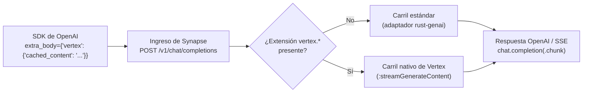

Una de las mayores ventajas en costo y latencia de Gemini en Google Cloud Vertex AI es **Context
Caching** (`cachedContent`). Cuando su aplicación consulta repetidamente el mismo repositorio de
100,000 tokens, un corpus legal o un manual operativo del sistema, fijar ese prefijo en una caché de
Vertex AI reduce drásticamente el tiempo hasta el primer token (TTFT) y factura los tokens de prompt
en caché a una fracción de la tarifa estándar de entrada.

Solo hay un problema: si su equipo de ingeniería estandarizó el uso del **SDK de OpenAI** (`openai`
en Python o TypeScript) y enruta el tráfico a través de un proxy convencional compatible con OpenAI,
`cachedContent` desaparece. Los proxies de traducción genéricos aplanan cada cuerpo entrante de
`POST /v1/chat/completions` a una estructura de chat de mínimo común denominador, descartando
silenciosamente los campos específicos del proveedor antes de que la solicitud llegue a Vertex AI.

Synapse resuelve esto con su **arquitectura de doble carril**. Su aplicación sigue importando
exactamente el mismo cliente de OpenAI y llamando a `client.chat.completions.create(...)`, pasando
un bloque de extensión `vertex` mediante `extra_body`. Cuando Synapse detecta
`vertex.cached_content`, evita el adaptador genérico y enruta la llamada por su **carril nativo de
Vertex** directamente al endpoint `:streamGenerateContent` de Vertex AI, preservando intacto el
identificador de contexto en caché y traduciendo la respuesta de vuelta a tramas estándar
`chat.completion` (o SSE `chat.completion.chunk`) de OpenAI.

<!-- truncate -->

## Por qué los proxies genéricos de OpenAI descartan `cachedContent`

Un gateway estándar compatible con OpenAI trata a todos los proveedores ascendentes de forma
idéntica:

1. Deserializa `POST /v1/chat/completions` en campos estrictos de OpenAI (`model`, `messages`, `temperature`, `tools`, `response_format`).
2. Descarta cualquier clave desconocida de nivel superior (`extra_body`).
3. Recodifica la solicitud normalizada a través de un adaptador genérico de proveedor.

Dado que la especificación Chat Completions de OpenAI no tiene el concepto de un nombre de recurso
de caché explícito del lado del servidor (`projects/.../locations/.../cachedContents/...`), un proxy
de un solo carril no tiene dónde colocarlo. Los equipos se ven obligados a elegir entre dos opciones
indeseables: abandonar el SDK de OpenAI y reescribir los puntos de llamada contra el SDK de Google
GenAI / Vertex, o pagar el precio completo y la latencia total de prefill en cada turno.

## Cómo funciona el conmutador de doble carril de Synapse

Synapse inspecciona cada carga útil de `POST /v1/chat/completions` en el ingreso. Si la solicitud
contiene un objeto `vertex` de nivel superior con `cached_content`, `response_schema` o
`thinking_config`, el detector de carril (`RequestWithVertex::needs_native_vertex`) conmuta esa
solicitud del **carril estándar** (`rust-genai`) al **carril nativo de Vertex**
(`NativeVertexClient`).



En el carril nativo de Vertex, Synapse:

- Resuelve el tramo (`leg`) de la ruta en `config/routes.toml` y verifica que el primer tramo sea `provider = "vertex"`.
- Adquiere y almacena en caché un token portador OAuth2 de Google Cloud mediante Application Default Credentials (ADC).
- Emite un `GenerateContentRequest` nativo de Vertex AI con `cachedContent` configurado con el nombre de su recurso de caché.
- Transmite `:streamGenerateContent?alt=sse` y convierte cada fragmento de Vertex en una respuesta o fragmento SSE compatible con OpenAI, incluyendo la contabilidad completa de uso de tokens.

## Paso 1: Configurar una ruta de Vertex en `config/routes.toml`

Las cachés de contexto de Vertex AI son recursos regionales: una caché creada en `us` o
`us-central1` solo puede ser consumida por solicitudes enviadas exactamente a esa misma ubicación y
versión de modelo. Apunte el primer tramo de su ruta al `model` y `region` correspondientes de
Vertex:

```toml
[routes."gemini-pro"]
strategy = "priority"
legs = [
  { provider = "vertex", model = "gemini-2.5-pro", region = "us", project_env = "GCP_PROJECT" },
]
```

Inicie Synapse con Application Default Credentials configuradas:

```bash
export GCP_PROJECT="my-gcp-project"
gcloud auth application-default login
cargo run --release -p synapse-gateway
```

## Paso 2: Crear un recurso `cachedContent` en Vertex AI

Usted crea la caché una sola vez (o según un cronograma de renovación de TTL) usando la API REST de
Vertex AI o el SDK de Google GenAI. Aquí hay una llamada mínima con `curl` que almacena en caché un
prompt de sistema grande y una instantánea del código fuente durante una hora (`3600s`) en la región
`us`:

```bash
CACHE_NAME=$(curl -sS -X POST \
  "https://aiplatform.googleapis.com/v1beta1/projects/${GCP_PROJECT}/locations/us/cachedContents" \
  -H "Authorization: Bearer $(gcloud auth application-default print-access-token)" \
  -H "Content-Type: application/json" \
  -d '{
    "model": "projects/'"${GCP_PROJECT}"'/locations/us/publishers/google/models/gemini-2.5-pro",
    "systemInstruction": {
      "parts": [{ "text": "You are a principal Rust security auditor reviewing the Synapse gateway repository." }]
    },
    "contents": [{
      "role": "user",
      "parts": [{ "text": "<... 60,000 tokens of repository source files and architecture specs ...>" }]
    }],
    "ttl": "3600s"
  }' | jq -r '.name')

echo "Created cache: ${CACHE_NAME}"
# projects/my-gcp-project/locations/us/cachedContents/1234567890123456789
```

:::tip Umbral mínimo de tokens
Vertex AI exige un conteo mínimo de tokens para el almacenamiento en caché de contexto (típicamente
32,768 tokens en Gemini 2.5 Pro y 4,096 tokens en modelos Flash). Las cargas útiles por debajo del
umbral devuelven `400 INVALID_ARGUMENT` al momento de crear la caché.
:::

## Paso 3: Consultar la caché desde el SDK estándar de OpenAI

Ahora llame a Synapse en `http://localhost:8080/v1` usando el SDK de OpenAI sin modificaciones. Pase
el identificador de caché dentro de `extra_body.vertex.cached_content` (en Python) o en la propiedad
`vertex` (en TypeScript / HTTP crudo):

### Python (SDK `openai`)

```python
import os
from openai import OpenAI

client = OpenAI(
    base_url="http://localhost:8080/v1",
    api_key="synapse-local",  # o su token portador de Synapse
)

cache_name = os.environ["CACHE_NAME"]

response = client.chat.completions.create(
    model="gemini-pro",
    messages=[
        {
            "role": "user",
            "content": "List every place where upstream HTTP errors are classified as retryable.",
        }
    ],
    extra_body={
        "vertex": {
            "cached_content": cache_name,
        }
    },
)

print(response.choices[0].message.content)
print("Usage:", response.usage)
```

### Streaming + combinación de `cached_content` con `response_schema` y `thinking_config`

Dado que `cached_content`, `response_schema` y `thinking_config` residen dentro del mismo bloque de
extensión `vertex`, puede combinar **contexto en caché**, **presupuestos de pensamiento de Gemini**
y **decodificación estricta restringida por esquema de Vertex** en una sola llamada del SDK de
OpenAI:

```python
stream = client.chat.completions.create(
    model="gemini-pro",
    stream=True,
    messages=[
        {
            "role": "user",
            "content": "Return the retryable HTTP status codes and their backoff policy.",
        }
    ],
    extra_body={
        "vertex": {
            "cached_content": cache_name,
            "thinking_config": {
                "thinking_budget": 1024,
            },
            "response_schema": {
                "type": "OBJECT",
                "properties": {
                    "retryable_statuses": {
                        "type": "ARRAY",
                        "items": {"type": "INTEGER"},
                    },
                    "uses_exponential_backoff": {"type": "BOOLEAN"},
                },
                "required": ["retryable_statuses", "uses_exponential_backoff"],
            },
        }
    },
)

for chunk in stream:
    delta = chunk.choices[0].delta.content
    if delta:
        print(delta, end="", flush=True)
```

Synapse elimina automáticamente las partes internas `thought` de Gemini del flujo de salida, por lo
que los fragmentos `delta.content` concatenados forman JSON puro conforme a su `response_schema`.

## Verificación de la ejecución en el carril nativo y atribución de costos

Cada solicitud atendida a través del carril nativo de Vertex se etiqueta con `lane="native"` tanto
en las métricas de Prometheus como en el libro mayor de costos en SQLite / Postgres:

```bash
curl -s http://localhost:8080/metrics | grep 'synapse_requests_total.*lane="native"'
```

```text
synapse_requests_total{gen_ai_request_model="gemini-pro",gen_ai_response_model="gemini-2.5-pro",gen_ai_system="vertexai",http_response_status_code="200",lane="native"} 2
```

Y en la tabla `requests` del libro mayor:

```bash
sqlite3 synapse.db \
  "SELECT timestamp, route, model, lane, input_tokens, output_tokens, cost_usd FROM requests ORDER BY id DESC LIMIT 2;"
```

:::note Precios de tokens en caché en el libro mayor
`usageMetadata.promptTokenCount` de Vertex AI incluye tanto los tokens de prompt en caché como los
no almacenados en caché, y también informa `cachedContentTokenCount`. Actualmente, Synapse calcula
el precio del conteo total de `input_tokens` a la tarifa `input` configurada del modelo en
`config/pricing.toml`; el desglose dedicado de tarifas `cached_input` está programado en la hoja de
ruta.
:::

## Pruébelo hoy

No necesita bifurcar el código de su aplicación ni mantener dos bibliotecas cliente de LLM separadas
solo para desbloquear Gemini Context Caching. Apunte su SDK de OpenAI existente a Synapse, adjunte
`extra_body.vertex.cached_content` y deje que el carril nativo de Vertex se encargue del resto.

- **Tutorial paso a paso**: [Pasar `cached_content` a Vertex AI](/docs/get-started/tutorials/native-vertex-caching/)
- **Referencia completa**: [Guía del carril nativo de Vertex](/docs/guides/native-vertex/)
