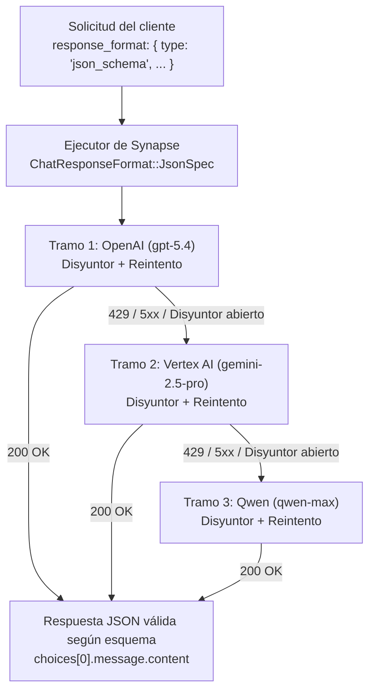

Los pipelines de IA en producción rara vez consumen texto libre hoy en día. Ya sea que esté
extrayendo partidas de facturas, clasificando alertas de seguridad o impulsando una máquina de
estados determinista, el servicio consumidor espera una **carga útil estricta en JSON Schema**: no
un bloque de código markdown, no un preámbulo conversacional y, ciertamente, no un `502 Bad Gateway`
cuando el proveedor primario sufre un pico de límite de tasa.

Construir un failover multiproveedor (`OpenAI` → `Vertex AI` → `Qwen`) parece sencillo hasta que las
salidas estructuradas entran en escena. Muchos equipos descubren durante un incidente que el tramo
de su proveedor de respaldo descarta silenciosamente `response_format.json_schema` y vuelve a texto
sin restricciones, o filtra tokens `thought` de razonamiento dentro del cuerpo JSON, convirtiendo un
`429` transitorio ascendente en una caída crítica por `JSONDecodeError` en producción.

En este artículo analizaremos cómo Synapse ejecuta **fallbacks multiproveedor que preservan el
esquema**: traduciendo especificaciones `json_schema` de OpenAI entre proveedores heterogéneos en el
carril estándar, conmutando entre regiones de Vertex AI con decodificación restringida nativa
`responseSchema` en el carril nativo y protegiendo cada tramo con disyuntores (*circuit breakers*)
independientes.

<!-- truncate -->

## Por qué el failover multiproveedor ingenuo rompe las salidas estructuradas

Cuando una aplicación envía una solicitud de extracción estructurada usando el parámetro
`response_format` del SDK de OpenAI, tres modos de fallo suelen romper los envoltorios caseros de
fallback:

1. **Eliminación del esquema en proveedores secundarios.** Un proxy ingenuo pasa `response_format: { "type": "json_schema", ... }` a OpenAI, pero cuando OpenAI devuelve `429 Too Many Requests` o `503 Service Unavailable`, el adaptador de respaldo degrada la solicitud a texto plano o al modo genérico `json_object` en Gemini, perdiendo tipos de propiedades, arreglos `required` y restricciones `enum`.
2. **Truncamiento a mitad del flujo.** Si un cliente sin streaming usa un proxy de paso directo sin búfer y la conexión ascendente cae a mitad de la generación de un objeto JSON, el cliente recibe una carga útil truncada `{ "invoice_id": "INV-104", "items": [` que no puede reintentarse limpiamente.
3. **Contaminación por tokens de razonamiento.** En modelos Gemini 2.5 / 3.x con capacidad de razonamiento, habilitar el pensamiento junto con la salida estructurada puede emitir partes internas `thought` antes de la carga útil JSON final, a menos que el gateway las filtre explícitamente.

## Patrón 1: Fallback `json_schema` entre proveedores en el carril estándar

Cuando su cliente envía un bloque estándar `response_format` de OpenAI (`type: "json_schema"` o
`type: "json_object"`), el ejecutor de Synapse (`to_genai_options`) convierte el esquema en un
`ChatResponseFormat::JsonSpec` neutral respecto al proveedor (incluyendo `schema_name`, `schema` y
`strict`) y adjunta esa especificación a **cada tramo** de la cadena de fallback de su ruta.



### Configuración de `config/routes.toml`

Aquí hay una ruta por prioridad que comienza en OpenAI (`gpt-5.4`), conmuta por error a Google Cloud
Vertex AI (`gemini-2.5-pro`) y mantiene Alibaba Cloud DashScope (`qwen-max`) como tercer tramo,
protegida por un disyuntor por tramo y retroceso exponencial (*exponential backoff*):

```toml
[routes."structured-extractor"]
strategy = "priority"
legs = [
  { provider = "openai", model = "gpt-5.4", api_key_env = "OPENAI_API_KEY" },
  { provider = "vertex", model = "gemini-2.5-pro", region = "us-central1", project_env = "GCP_PROJECT" },
  { provider = "qwen",   model = "qwen-max", api_key_env = "DASHSCOPE_API_KEY" },
]

[retry]
max_attempts = 2
initial_backoff_ms = 150
max_backoff_ms = 1500

[circuit_breaker]
failure_threshold = 3
cooldown_secs = 30
```

### Llamada a la ruta con `json_schema` de OpenAI

El código de su aplicación utiliza una única definición de `response_format` y nunca necesita saber
qué proveedor ascendente atendió finalmente la llamada:

```python
import json
from openai import OpenAI

client = OpenAI(
    base_url="http://localhost:8080/v1",
    api_key="synapse-local",
)

incident_schema = {
    "type": "object",
    "properties": {
        "service": {"type": "string"},
        "severity": {"type": "string", "enum": ["SEV1", "SEV2", "SEV3"]},
        "affected_regions": {
            "type": "array",
            "items": {"type": "string"},
        },
        "requires_rollback": {"type": "boolean"},
    },
    "required": ["service", "severity", "affected_regions", "requires_rollback"],
    "additionalProperties": False,
}

response = client.chat.completions.create(
    model="structured-extractor",
    messages=[
        {
            "role": "system",
            "content": "Extract structured incident metadata from the pager alert.",
        },
        {
            "role": "user",
            "content": "ALERT: Checkout API p99 latency > 12s in us-east-1 and eu-west-1 after deploy v2.14.3. Rollback initiated.",
        },
    ],
    response_format={
        "type": "json_schema",
        "json_schema": {
            "name": "incident_report",
            "strict": True,
            "schema": incident_schema,
        },
    },
)

payload = json.loads(response.choices[0].message.content)
print(payload)
# {'service': 'Checkout API', 'severity': 'SEV1', 'affected_regions': ['us-east-1', 'eu-west-1'], 'requires_rollback': True}
```

### ¿Qué sucede cuando OpenAI falla?

1. **Clasificación de fallos reintentables**: Si OpenAI devuelve `429 Too Many Requests`, `408 Request Timeout`, cualquier `5xx` o un tiempo de espera de transporte, Synapse reintenta `openai/gpt-5.4` hasta `max_attempts` con retroceso exponencial. Los errores de cliente no reintentables (`400`, `401`, `422`) omiten los reintentos de inmediato.
2. **Contabilidad del disyuntor**: Los fallos consecutivos en `openai/gpt-5.4` incrementan el contador de su disyuntor. Una vez que alcanza `failure_threshold = 3`, el disyuntor pasa a estado **Abierto** (`synapse_circuit_breaker_state{leg="openai/gpt-5.4"} = 2`) durante `cooldown_secs = 30`. Las solicitudes posteriores omiten OpenAI en cero milisegundos y van directamente a Vertex AI.
3. **Cero pérdida de esquema en el Tramo 2**: Synapse despacha exactamente el mismo `ChatResponseFormat::JsonSpec` a `vertex/gemini-2.5-pro`.
4. **Semántica de failover con búfer frente a streaming**:
   - Para llamadas **con búfer (`stream: false`)**, incluso si el Tramo 1 corta la conexión a mitad de la generación, Synapse descarta el búfer parcial y conmuta limpiamente al Tramo 2.
   - Para llamadas **en streaming (`stream: true`)**, cualquier fallo *antes* de que se escriba el primer fragmento SSE hacia el cliente activa un failover transparente al Tramo 2. Una vez que se han enviado bytes por el cable, Synapse nunca empalma el flujo de tokens de un segundo modelo dentro de un objeto JSON escrito a medias.

## Patrón 2: `response_schema` nativo de Vertex con fallback multirregión en Vertex

Cuando su carga de trabajo requiere funciones de decodificación estructurada específicas de Google
—como combinar `response_schema` (`generationConfig.responseSchema` con
`responseMimeType: "application/json"`) junto con `cached_content` y `thinking_config`—, Synapse
enruta la solicitud por el **carril nativo de Vertex** y recorre los tramos consecutivos de `vertex`
en su ruta ante cualquier fallo:

```toml
[routes."vertex-strict-json"]
strategy = "priority"
legs = [
  { provider = "vertex", model = "gemini-3.1-pro-preview", region = "global",      project_env = "GCP_PROJECT" },
  { provider = "vertex", model = "gemini-2.5-pro",         region = "us-central1", project_env = "GCP_PROJECT" },
  { provider = "vertex", model = "gemini-2.5-flash",       region = "europe-west4", project_env = "GCP_PROJECT" },
]
```

Cuando pasa `extra_body.vertex.response_schema`:

```bash
curl -sS http://localhost:8080/v1/chat/completions \
  -H "Content-Type: application/json" \
  -d '{
    "model": "vertex-strict-json",
    "messages": [
      { "role": "user", "content": "Extract the CVE ID and CVSS score: CVE-2026-4102 (CVSS 9.1)" }
    ],
    "vertex": {
      "thinking_config": { "thinking_budget": 1024 },
      "response_schema": {
        "type": "OBJECT",
        "properties": {
          "cve_id": { "type": "STRING" },
          "cvss_score": { "type": "NUMBER" }
        },
        "required": ["cve_id", "cvss_score"]
      }
    }
  }'
```

En el carril nativo de Vertex, Synapse garantiza dos propiedades críticas para las salidas
estructuradas:

1. **Failover multirregión / multimodelo en Vertex**: Si `gemini-3.1-pro-preview` en `global` devuelve `429 RESOURCE_EXHAUSTED` o `503 UNAVAILABLE`, Synapse avanza automáticamente a `gemini-2.5-pro` en `us-central1` (y luego a `gemini-2.5-flash` en `europe-west4`) preservando íntegramente `generationConfig.responseSchema`.
2. **Eliminación automática de `thought`**: Incluso con `thinking_budget: 1024` habilitado, Synapse filtra cada parte de Vertex marcada con `"thought": true` antes de construir `choices[0].message.content` (o `delta.content` en SSE) de OpenAI, asegurando que su analizador JSON nunca reciba texto interno de cadena de pensamiento.

## Observabilidad: saber cuándo y por qué se activó un fallback

Los fallbacks silenciosos que ocultan proveedores degradados son un riesgo operativo. Synapse expone
cada transición de tramo y cambio de estado del disyuntor:

- **Métricas de Prometheus**:
  - `synapse_circuit_breaker_state{leg="openai/gpt-5.4"}` (`0` = cerrado, `1` = semiabierto, `2` = abierto)
  - `synapse_requests_total{gen_ai_request_model="structured-extractor",gen_ai_response_model="gemini-2.5-pro",gen_ai_system="vertexai",...}` muestra cuándo una solicitud dirigida a `structured-extractor` fue atendida en realidad por `gemini-2.5-pro`.
- **Encabezados de agotamiento y cuerpo de error estructurado**: Si todos los tramos de la cadena fallan, Synapse responde con `502 Bad Gateway`, estampa `x-synapse-legs-attempted` y `x-synapse-routing-degraded: all_legs_failed`, y devuelve el desglose de fallos por tramo:

```json
{
  "error": {
    "type": "all_legs_failed",
    "message": "all legs failed for route 'structured-extractor'",
    "failures": [
      { "leg": "openai/gpt-5.4", "kind": "rate_limited", "retryable": true },
      { "leg": "vertex/gemini-2.5-pro", "kind": "upstream_5xx", "retryable": true },
      { "leg": "qwen/qwen-max", "kind": "timeout", "retryable": true }
    ]
  }
}
```

## Próximos pasos

- **Tutorial práctico**: [Conmutación por error de OpenAI a Vertex AI](/docs/get-started/tutorials/fallback-across-providers/)
- **Análisis en profundidad**: [Cadenas de fallback, reintentos y disyuntores](/docs/guides/fallback-chains/)
- **Referencia de esquemas en Vertex**: [Carril nativo de Vertex (`response_schema` y `thinking_config`)](/docs/guides/native-vertex/)
